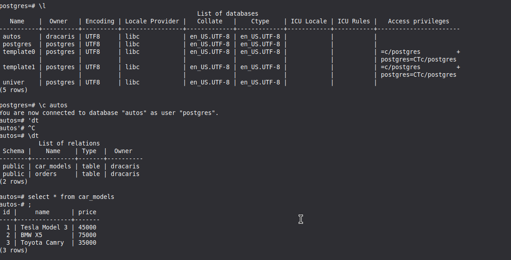

Задание 1
``python
1. docker build -t php_app .
2. docker run -d -it --name php-web-1 -p 8000:80 -v ./index.php:/var/www/index.php php_app
```



Задание 2

``python
1. docker build -t sayhello .
2. docker run -d -it --name sayhello-1 -v ./hello.py:/app/hello.py sayhello
```


Задание 3

``python
1. docker build -t php .
2. docker run -d -it --name phpinfo-1 -v ./info.php:/app/info.php php:latest
3. docker exec -it phpinfo-1 bash

root@c3115fbad844:/# php /app/info.php
php Версия ОС сервера: Linux 6b53817c4c3f 5.10.0-34-amd64 #1 SMP Debian 5.10.234-1 (2025-02-24) x86_64 Тип ОС сервера: Linux IP-адрес сервера: 172.17.0.2

```


