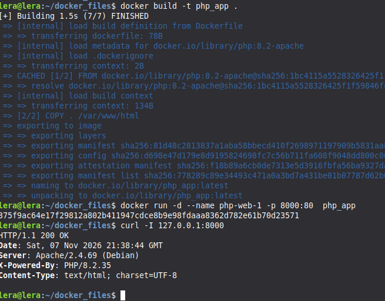
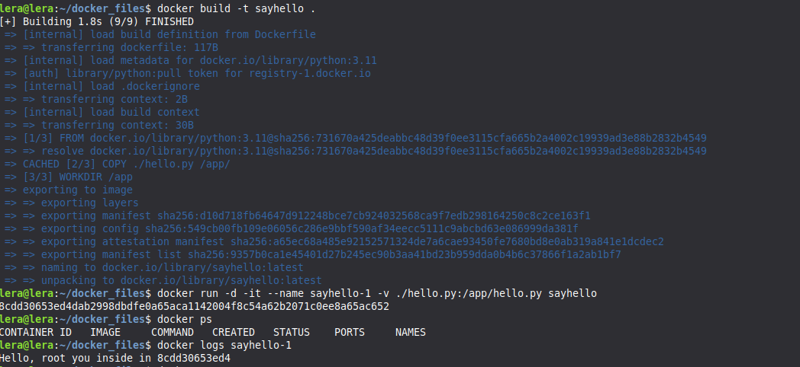
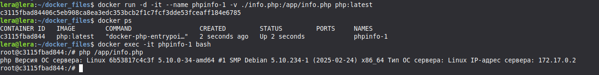
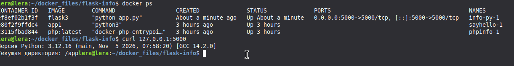
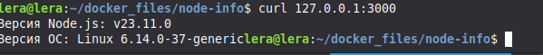

Задание 1

```python
1. docker build -t php_app .
2. docker run -d -it --name php-web-1 -p 8000:80 -v ./index.php:/var/www/index.php php_app
```


Задание 2

```python
1. docker build -t sayhello .
2. docker run -d -it --name sayhello-1 -v ./hello.py:/app/hello.py sayhello
3. docker exec -it sayhello-1 bash
```



Задание 3

```python
1. docker build -t php .
2. docker run -d -it --name phpinfo-1 -v ./info.php:/app/info.php php:latest
3. docker exec -it phpinfo-1 bash
```



Задание 4

```python
1. docker build -t flask3 .
2. docker run -d -it --name info-py-1 -v ./app.py:/app/app.py -p 5000:5000 flask3
```




Задание 5

```python
1. docker build -t js:v1 .
2. docker run -d -it --name info-node-1 -p 3000:3000 js:v1
```



