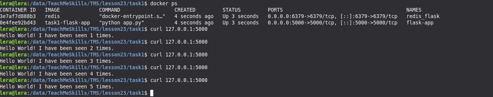

Задание 1
Запустить с помощью docker compose приложения https://gitlab.com/dos-29-onl/docker-apps/-/tree/main/compose-apps/nodejs-app_01?ref_type=heads

```python
Dockerfile https://github.com/Anitsupakl/TMS/blob/main/lesson23/task1/Dockerfile 
docker compose https://github.com/Anitsupakl/TMS/blob/main/lesson23/task1/docker-compose.yaml
```



Задание 2
Запустить с помощью docker compose приложения  https://gitlab.com/dos-29-onl/docker-apps/-/tree/main/compose-apps/python-app_01?ref_type=heads

```python
Dockerfile https://github.com/Anitsupakl/TMS/blob/main/lesson23/task2/Dockerfile
docker compose https://github.com/Anitsupakl/TMS/blob/main/lesson23/task2/docker-compose.yaml
```


