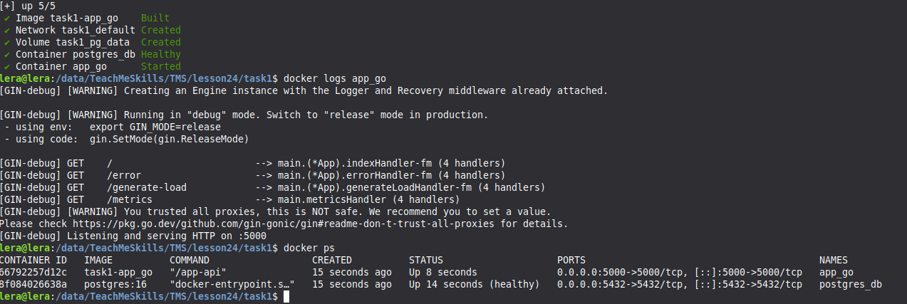
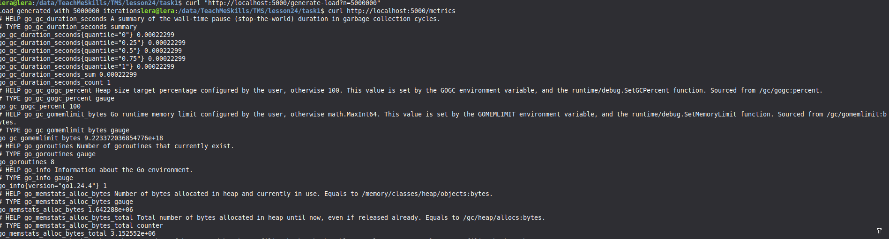
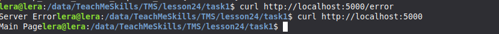

# Задание 1 \
https://gitlab.com/dos-29-onl/docker-apps/-/tree/main/compose-apps/golang-app_01?ref_type=heads \
Dockerfile https://github.com/Anitsupakl/TMS/blob/main/lesson24/task1/Dockerfile \
docker compose https://github.com/Anitsupakl/TMS/blob/main/lesson24/task1/docker-compose.yaml \

Проверка контейнеров \

Курлы:

    
    
    
    
    
    https://gitlab.com/dos-29-onl/docker-apps/-/tree/main/compose-apps/python-app_02?ref_type=heads
    https://gitlab.com/dos-29-onl/log-app

