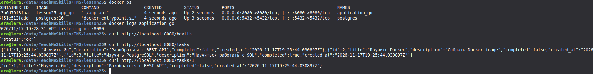

# Задание 1 
Запустить с помощью docker приложение https://github.com/anestesia001/go-task-manager \
Dockerfile https://github.com/Anitsupakl/TMS/blob/main/lesson25/Dockerfile \
docker compose https://github.com/Anitsupakl/TMS/blob/main/lesson25/docker-compose.yaml \

Проверка контейнеров и курл \


```python
#!/usr/bin/env python3

import subprocess

containers_name = ["redis", "mongo", "application_go"]

result = subprocess.run(
    ["docker", "ps", "--format", "{{.Names}}"],
    capture_output=True,
    text=True,
    check=True
    )
active_containers = result.stdout

for containers in containers_name:
    if containers in active_containers:
        print(f"Контейнер '{containers}' запущен.")
```

