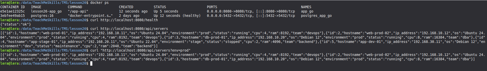

# Задание 1 
Запустить в docker приложение https://github.com/anestesia001/cmdb-37/tree/main\
Dockerfile https://github.com/Anitsupakl/TMS/blob/main/lesson26/Dockerfile \
docker compose https://github.com/Anitsupakl/TMS/blob/main/lesson26/docker-compose.yaml \

курл \

# Задание 2
Написать скрипт, который обращается к CMDB API и выводит 

    список всех серверов 
    список серверов конкретного окружения (dev/prod/etc) 
    список серверов в заданном через аргумент состоянии (runnung/stopped/maintenance) 
    
https://github.com/Anitsupakl/TMS/blob/main/lesson26/check_list_servers.py

# Задание 3
Написать скрипт, который обращается к CMDB API и добавляет или удаляет сервер \
https://github.com/Anitsupakl/TMS/blob/main/lesson26/add_delete_servers.py
